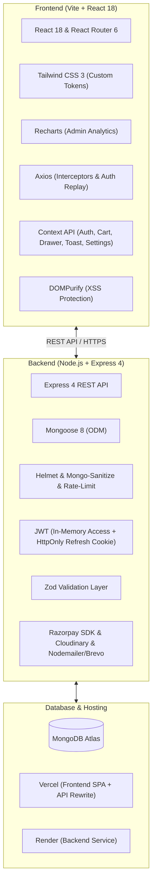
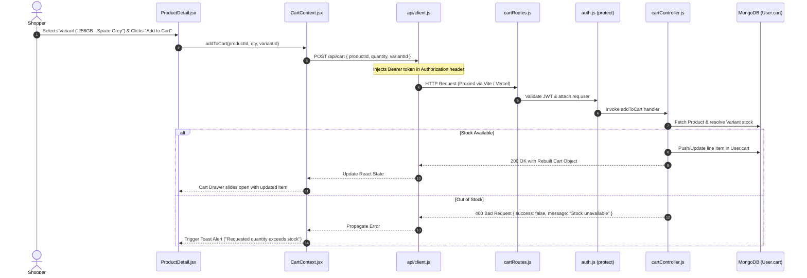
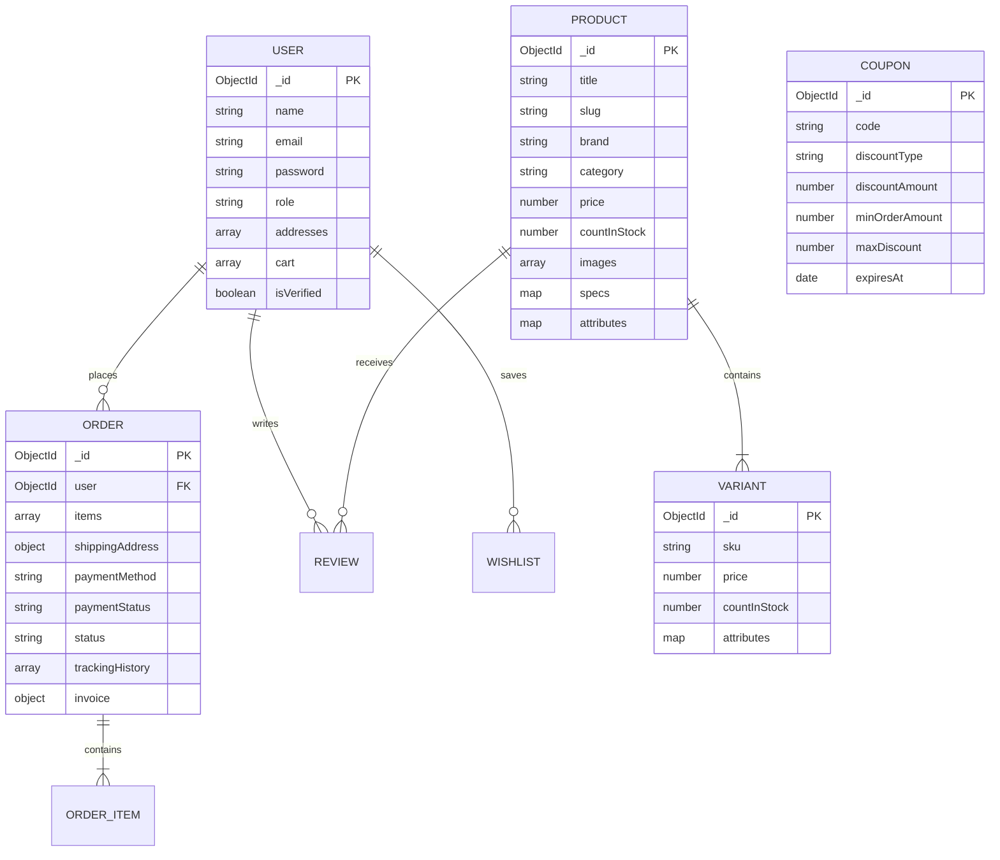

# NexaMart — Electronics E-Commerce Marketplace

<div align="center">


<p align="center">
  A production-grade, Flipkart-inspired full-stack MERN e-commerce marketplace featuring multi-attribute product variants, dynamic SKU matrix, variant-aware cart & checkout, Razorpay & Cash-on-Delivery payment flows, live order tracking timelines, tax invoice generation, and a dedicated <b>Seller Hub (Admin Console)</b>.
</p>

[**🌐 Live Storefront**](https://nexa-mart-psi.vercel.app) &nbsp;&bull;&nbsp; [**⚡ Live API**](https://nexa-mart.onrender.com/api) &nbsp;&bull;&nbsp; [**👨‍💻 Author GitHub**](https://github.com/zaid154) &nbsp;&bull;&nbsp; [**💼 LinkedIn**](https://www.linkedin.com/in/mohd-zaid-794090231/)

</div>

---

## 📌 Live Deployments & Local Ports

| Environment | URL / Endpoint | Description |
| :--- | :--- | :--- |
| **Production Storefront** | [https://nexa-mart-psi.vercel.app](https://nexa-mart-psi.vercel.app) | Deployed on Vercel with automatic API rewrite proxy |
| **Production API** | [https://nexa-mart.onrender.com/api](https://nexa-mart.onrender.com/api) | Deployed on Render with cold-start mitigation banner |
| **Local Storefront** | `http://localhost:5173` | Vite 5 Dev Server with hot module replacement (HMR) |
| **Local Seller Hub** | `http://localhost:5173/admin` | Full-featured Admin Dashboard & Control Center |
| **Local API Server** | `http://localhost:5000/api` | Express 4 REST API with MongoDB connection |

> **Render Free-Tier Cold Starts:** The live API is hosted on Render's free tier, which goes into standby after periods of inactivity. The first request may take ~30–50 seconds to spin up. NexaMart features a built-in countdown banner and automatic Axios retry mechanism so user sessions are seamlessly resumed.

---

## 📑 Table of Contents

1. [Key Features](#-key-features)
2. [Quick Start & Installation](#-quick-start--installation)
3. [Demo Accounts](#-demo-accounts)
4. [Tech Stack](#-tech-stack)
5. [Architecture & Request Flow](#-architecture--request-flow)
6. [Repository Structure](#-repository-structure)
7. [Backend Architecture](#-backend-architecture)
8. [Frontend Architecture](#-frontend-architecture)
9. [Data Models & Schema Design](#-data-models--schema-design)
10. [Product Variants & SKU Engine](#-product-variants--sku-engine)
11. [API Reference](#-api-reference)
12. [Security & OWASP Hardening](#-security--owasp-hardening)
13. [Seed Data](#-seed-data)
14. [Environment Variables](#-environment-variables)
15. [Deployment Guide](#-deployment-guide)
16. [Design System & Tokens](#-design-system--tokens)
17. [Troubleshooting & FAQs](#-troubleshooting--faqs)
18. [Author & Contact](#-author--contact)

---

## ✨ Key Features

### 🛍️ Storefront & User Experience
- **Flipkart-Style Design Language:** Signature blue headers, flat white cards, green rating pills, amber/orange dual CTA action pairs (`Add to Cart` / `Buy Now`), and seamless 4-step accordion checkout.
- **Dynamic Product Variant Engine:** Real-time attribute switching (e.g. *Storage: 256GB / 512GB*, *Color: Space Grey / Silver*), dynamic SKU resolving, variant image swatches, instant pricing, and stock status sync.
- **Cart Drawer & Persisted State:** Instant slide-in cart drawer upon adding items, optimistic quantity adjustments, free-delivery qualification progress bar, and saved-for-later management.
- **Comprehensive Search & Faceted Filters:** Multi-criteria catalog filtering (category, brand, price slider, customer rating, stock availability), instant search bar with query suggestions, and sort tabs.
- **Wishlist Management:** One-click wishlist save/unsave, quick "Move to Cart" actions, and persistent user sync.
- **Mobile-First Responsive Layout:** Custom bottom navigation bar for handheld devices, collapsible filter drawer, touch-friendly swipers, and sticky mobile purchase bars.

### 💳 Checkout, Orders & Invoicing
- **Multi-Step Checkout:** Verified Indian address validation (regex phone `^[6-9]\d{9}$` and pincode `^[1-9]\d{5}$`), delivery speed estimation, and address book selector.
- **Dual Payment Gateways:** 
  - **Razorpay Integration:** Secure signature verification, pop-up payment checkout, webhook capture, and auto-retry for abandoned orders.
  - **Cash on Delivery (COD):** Instant order placement with zero upfront payment and automatic status progression.
- **Live Order Tracking Timeline:** Visual step-by-step milestone timeline (`Ordered` &rarr; `Confirmed` &rarr; `Packed` &rarr; `Shipped` &rarr; `Out for Delivery` &rarr; `Delivered`), with audit timestamps and color-coded status badges.
- **Automated Tax Invoice Generation:** Printable, GST-compliant tax invoices with company seal, buyer details, itemized HSN/variant breakdowns, and discounts.
- **Returns & Cancellation Workflow:** Self-serve order cancellation with automated stock rollback; return request submission with photo upload attachments and reason tracking.

### 👑 Seller Hub (Admin Console)
- **Executive Analytics Dashboard:** Real-time GMV revenue counter, order volume charts, order status breakdown bar charts (powered by Recharts), and recent audit log feed.
- **Complete Product Management:** Multi-image upload (Cloudinary / MongoDB memory fallback), rich specification editor, benefit bullet points, and dynamic variant combination generator.
- **Order Fulfillment Center:** Update delivery stages, trigger customer notifications, process partial/full refunds, and add private admin notes.
- **Return & Refund Desk:** Review buyer return submissions with attached photos, inspect reasons, and approve or reject returns.
- **Coupon & Promotion Engine:** Percentage and fixed discounts, minimum cart value thresholds, maximum discount caps, per-user usage limits, and expiration controls.
- **CMS & Store Configuration:** Visual page builder for static policies (Terms, Privacy, Shipping, Seller guidelines), global tax/shipping rules, store metadata, and SMTP / Brevo mailer diagnostics.
- **Activity Logs & CSV Export:** Immutable security audit logs recording admin actions, with 1-click CSV exports for products and orders.

---

## 🚀 Quick Start & Installation

### Prerequisites
- **Node.js**: `v20.x` or higher
- **npm**: `v10.x` or higher
- **MongoDB**: Local MongoDB instance or MongoDB Atlas cluster URI

### Step-by-Step Setup

```bash
# 1. Clone the repository
git clone https://github.com/zaid154/Nexa-Mart.git
cd Nexa-Mart

# 2. Install all root, backend, and frontend dependencies
npm run install:all

# 3. Configure environment variables (create .env in root)
cp .env.example .env
# Edit .env and supply your MONGO_URI and JWT secrets (see Environment Variables section)

# 4. Populate database with demo products, variants, users, and orders
npm run seed

# 5. Start development servers concurrently
npm run dev
```

### Available NPM Scripts

| Script | Command | Purpose |
| :--- | :--- | :--- |
| `npm run install:all` | Root + sub-packages | Installs dependencies across root, `backend/`, and `frontend/` |
| `npm run dev` | `concurrently` | Starts Express API (`:5000`) and Vite frontend (`:5173`) together |
| `npm run seed` | `node backend/src/seed/seed.js` | Drops database and inserts 34 products, 99 variants, users, coupons, and orders with Cloudinary CDN media |
| `npm run cloudinary:upload` | `node backend/src/seed/uploadCloudinary.js` | Synchronizes local photography to Cloudinary under `Nexa Mart/products/` |
| `npm run setup` | `install:all && seed` | One-shot setup script for newly cloned repositories |
| `npm run build` | `vite build` | Compiles optimized production bundle into `frontend/dist` |

---

## 👥 Demo & Super Admin Accounts

Pre-populated accounts created during database seeding:

| Role | Email Address | Password | Permissions & Features |
| :--- | :--- | :--- | :--- |
| 👑 **Super Admin** | `zaidm1323@gmail.com` | `123456` | **Sole Root Super Admin**: Full Seller Hub access, product CRUD, returns & online refund processing, sales analytics, site settings |
| 👤 **Customer** | `user@shop.com` | `User@123` | Storefront browsing, cart, checkout, live order tracking, wishlist, verified product reviews |
| 👤 **Customer (Priya)** | `priya.sharma@example.com` | `Priya@123` | Pre-existing orders, saved addresses across Mumbai, verified review history |
| 👤 **Customer (Rohan)** | `rohan.mehta@example.com` | `Rohan@123` | Bengaluru address, delivered orders with active return window |
| 👤 **Customer (Ananya)** | `ananya.iyer@example.com` | `Ananya@123` | Chennai address, order tracking and wishlist items |

---

## 🛠️ Tech Stack



### Frontend
- **Core:** React 18, Vite 5, React Router 6 (Lazy Loaded Route Code-Splitting)
- **Styling:** Tailwind CSS 3 with custom brand tokens, responsive grid layouts, and custom utility classes
- **State Management:** React Context API (`AuthContext`, `CartContext`, `CartDrawerContext`, `SettingsContext`, `ToastContext`, `ConfirmContext`)
- **Data Visualization:** Recharts for admin analytics and sales tracking
- **Security & Utilities:** DOMPurify for HTML sanitization, Axios for network requests with automatic token refresh

### Backend
- **Runtime & Framework:** Node.js 20 LTS, Express 4
- **Database Layer:** MongoDB with Mongoose 8 ODM schemas, indexes, and aggregation pipelines
- **Authentication:** Dual-token JWT architecture (Short-lived in-memory Access Token + Secure HttpOnly Refresh Cookie) + bcryptjs password hashing
- **Input Validation:** Zod schemas for request validation across auth, orders, and addresses
- **File Uploads & Media:** Multer memory storage with sharp optimizations, Cloudinary CDN support, and Buffer fallback
- **Integrations:** Razorpay SDK for online payments, Nodemailer / Brevo HTTPS API for transactional emails

---

## 🔄 Architecture & Request Flow

### End-to-End Add-to-Cart Flow



---

## 📂 Repository Structure

```
Nexa-Mart/
├── package.json                   # Root workspace scripts (install:all, dev, seed, build)
├── render.yaml                    # Render Infrastructure-as-Code blueprint
├── vercel.json                    # Vercel deployment config with /api reverse proxy
├── .env.example                   # Template environment variables
├── .gitignore                     # Git ignore rules
│
├── backend/                       # Express REST API Server
│   ├── server.js                  # Application bootstrapper (Env check & DB connect)
│   ├── package.json               # Backend dependencies & scripts
│   └── src/
│       ├── createApp.js           # Express app factory (middleware, routes, error handler)
│       ├── config/                # Environment, DB, Razorpay, Cloudinary configurations
│       ├── controllers/           # Request handlers (auth, products, cart, orders, admin, etc.)
│       ├── middleware/            # Auth, Admin guard, Error handler, Multer uploads, Zod validation
│       ├── models/                # Mongoose schemas (User, Product, Order, Coupon, Page, Settings)
│       ├── routes/                # Express routing endpoints
│       ├── services/              # Business logic & external drivers (email, orders, tokens)
│       ├── seed/                  # Isolated database seeders & Cloudinary asset sync
│       ├── utils/                 # Lean cross-cutting utilities (coupons, otp, paginate, sku)
│       └── validators/            # Zod validation schemas
│
└── frontend/                      # React SPA (Vite)
    ├── index.html                 # Main HTML template with Google Fonts & Razorpay script
    ├── vite.config.js             # Vite config with API dev proxy & vendor chunk splitting
    ├── tailwind.config.js         # Design tokens (Flipkart blue, copper accents, typography)
    ├── package.json               # Frontend dependencies & scripts
    ├── public/
    │   └── images/                # Shipped product catalog photography & banners
    └── src/
        ├── main.jsx               # Application root wrapped in context providers
        ├── App.jsx                # Lazy-loaded route table & global banners
        ├── api/                   # Centralized Axios instance with interceptors
        ├── context/               # Auth, Cart, Drawer, Toast, Confirm, Settings contexts
        ├── components/            # Reusable UI components (Navbar, Footers, Steppers, Timeline)
        ├── pages/                 # Storefront pages (Catalog, ProductDetail, Cart, Checkout, etc.)
        ├── pages/admin/           # Seller Hub admin views (Dashboard, Products, Orders, Coupons, etc.)
        ├── styles/                # Tailwind entry point & component CSS recipes
        └── utils/                 # Formatting, address validation, Razorpay loader, pricing logic
```

---

## ⚙️ Backend Architecture

### Core Modules Breakdown

| Module / Directory | Key Files | Purpose & Responsibilities |
| :--- | :--- | :--- |
| **Configuration** | `config/db.js`<br>`config/env.js`<br>`config/razorpay.js`<br>`config/cloudinary.js` | Initializes MongoDB connection, performs boot-time environment validation, exports Razorpay and Cloudinary SDK singletons. |
| **Data Models** | `models/User.js`<br>`models/Product.js`<br>`models/Order.js`<br>`models/Coupon.js`<br>`models/Page.js`<br>`models/Settings.js`<br>`models/ActivityLog.js` | Defines Mongoose schemas with pre/post save hooks, bcrypt password hashing, slug generation, product rating recalculations, and variant embedding. |
| **Controllers** | `controllers/authController.js`<br>`controllers/productController.js`<br>`controllers/cartController.js`<br>`controllers/orderController.js`<br>`controllers/paymentController.js`<br>`controllers/adminController.js` | Implements end-to-end HTTP request handlers, transaction orchestration, and response formatting. |
| **Services Layer** | `services/emailService.js`<br>`services/emailTemplates.js`<br>`services/orderService.js`<br>`services/tokenService.js` | Decoupled business logic, mail delivery (SMTP / Brevo), inventory adjustment, and crypto SHA-256 token hashing. |
| **Middleware** | `middleware/auth.js`<br>`middleware/optionalAuth.js`<br>`middleware/error.js`<br>`middleware/upload.js`<br>`middleware/validate.js` | JWT verification, admin authorization guards, global error interception, Multer file upload handling, and Zod schema execution. |
| **Validators** | `validators/authValidators.js`<br>`validators/orderValidators.js` | Zod validation rules enforcing Indian mobile numbers (`^[6-9]\d{9}$`), 6-digit postal PIN codes, strong passwords, and payload sanity. |
| **Seed & Cloudinary** | `seed/seed.js`<br>`seed/seedData.js`<br>`seed/catalogue.js`<br>`seed/cloudinaryMap.js`<br>`seed/uploadCloudinary.js` | Standalone seed dataset, 34-product catalogue, Cloudinary asset syncing, and full database provisioning runner. |
| **Utilities** | `utils/coupons.js`<br>`utils/logger.js`<br>`utils/otp.js`<br>`utils/paginate.js`<br>`utils/productImages.js`<br>`utils/sku.js` | Lean cross-cutting helper functions without business coupling. |

---

## 💻 Frontend Architecture

### Context Providers & Hierarchy

The application state is structured hierarchically in `src/main.jsx`:

```
SettingsProvider (Store rules, tax rates, delivery threshold)
  └─ ToastProvider (Global notification toasts)
      └─ ConfirmProvider (Async confirmation modals for destructive actions)
          └─ AuthProvider (User profile, login/logout, in-memory JWT)
              └─ CartProvider (Persisted cart & wishlist synchronizer)
                  └─ CartDrawerProvider (High-performance slide-in drawer state)
                      └─ <App /> (Route table & page rendering)
```

### Component Highlights

| Component | Path | Description |
| :--- | :--- | :--- |
| `Navbar.jsx` | `src/components/Navbar.jsx` | Sticky Flipkart-blue header with logo, category navigation, search bar, login triggers, and live cart item count badge. |
| `MobileBottomNav.jsx` | `src/components/MobileBottomNav.jsx` | Fixed bottom action bar on mobile screens (Home, Categories, Wishlist, Orders, Profile). |
| `ProductCard.jsx` | `src/components/ProductCard.jsx` | Responsive catalog tile with image switcher, discount badges, green star rating pill, and instant Add-to-Cart trigger. |
| `ProductGallery.jsx` | `src/components/ProductGallery.jsx` | Thumbnail rail and high-resolution image viewer with zoom support and variant color selection. |
| `VariantPicker.jsx` | `src/components/VariantPicker.jsx` | Interactive selector for multi-attribute configurations (Storage, RAM, Color swatches) with dynamic stock updates. |
| `CartDrawer.jsx` | `src/components/CartDrawer.jsx` | Slide-in drawer with itemized summary, quantity steppers, free delivery progress, and direct Checkout CTA. |
| `OrderTimeline.jsx` | `src/components/OrderTimeline.jsx` | Milestone progress tracker indicating exact shipment stages based on recorded database events. |
| `BackendWakingBanner.jsx` | `src/components/BackendWakingBanner.jsx` | Non-intrusive alert banner showing a live countdown when Render's free API instance is waking up from sleep. |

---

## 🗄️ Data Models & Schema Design



---

## 🏷️ Product Variants & SKU Engine

NexaMart uses a multi-attribute variant architecture where each variant acts as an independent SKU carrying its own price, stock, and attributes:

```js
// backend/src/models/Product.js
variants: [{
  sku: { type: String, required: true },           // e.g. "APP-IPH15P-256-BLK"
  price: { type: Number, required: true },         // Variant specific price (₹)
  originalPrice: { type: Number },                 // MRP for discount calculation
  countInStock: { type: Number, default: 0 },      // Individual inventory count
  attributes: { type: Map, of: String }            // { Storage: "256 GB", Color: "Black Titanium" }
}]
```

### How the Variant Engine Operates:
1. **SKU Generation:** `sku.js` automatically generates deterministic, readable SKUs based on category, product slug, and attribute abbreviations.
2. **Dynamic Stock Aggregation:** The parent product's headline stock is automatically computed as the sum of all its active variants.
3. **Cart Isolation:** Adding two different configurations of the same product (e.g. *128GB* vs *256GB*) creates two distinct line items in `user.cart`.
4. **Order Immutability:** When an order is placed, the exact variant attributes, SKU, and unit price are permanently snapshotted into the order line items.
5. **Atomic Stock Rollback:** If an order is cancelled or rejected, `orderStatus.adjustStock()` restores the exact variant's inventory without affecting sibling variants.

---

## 📡 API Reference

All endpoints are hosted at `/api`. Protected routes require a valid JWT token.

### 🔐 Authentication (`/api/auth`)
| Method | Endpoint | Auth | Description |
| :--- | :--- | :---: | :--- |
| `POST` | `/register` | Public | Register new account and dispatch email OTP |
| `POST` | `/verify-otp` | Public | Verify OTP code and activate account |
| `POST` | `/resend-otp` | Public | Request a new OTP code |
| `POST` | `/login` | Public | Authenticate user and issue tokens |
| `POST` | `/refresh` | Public | Issue new access token via HttpOnly refresh cookie |
| `POST` | `/logout` | Public | Invalidate refresh token and clear cookie |
| `POST` | `/forgot-password` | Public | Send password reset OTP |
| `POST` | `/reset-password` | Public | Reset password using verified OTP |
| `GET` | `/profile` | 🔒 User | Retrieve current user profile and addresses |
| `PUT` | `/profile` | 🔒 User | Update profile details and address book |

### 📦 Products (`/api/products`)
| Method | Endpoint | Auth | Description |
| :--- | :--- | :---: | :--- |
| `GET` | `/` | Public | Paginated product list with search, brand, category, rating, and price filters |
| `GET` | `/filters` | Public | Get aggregate filter facets (categories, brands, price ranges) |
| `GET` | `/:id` | Public | Retrieve single product by ID/slug with active reviews |
| `POST` | `/` | 👑 Admin | Create a new product with image uploads and variant matrix |
| `PUT` | `/:id` | 👑 Admin | Update product details, specifications, and variants |
| `DELETE` | `/:id` | 👑 Admin | Delete product and associated reviews |

### 🛒 Cart & Wishlist (`/api/cart` & `/api/wishlist`)
| Method | Endpoint | Auth | Description |
| :--- | :--- | :---: | :--- |
| `GET` | `/cart` | 🔒 User | Fetch current user's cart with live variant prices and stock checks |
| `POST` | `/cart` | 🔒 User | Add product/variant to cart (increments quantity) |
| `PUT` | `/cart/:productId` | 🔒 User | Set absolute quantity for a specific cart line item |
| `DELETE` | `/cart/:productId` | 🔒 User | Remove a specific variant/product from cart |
| `DELETE` | `/cart` | 🔒 User | Clear all items from cart |
| `GET` | `/wishlist` | 🔒 User | Get saved wishlist items |
| `POST` | `/wishlist` | 🔒 User | Toggle product in/out of wishlist |

### 💳 Orders & Payments (`/api/orders` & `/api/payment`)
| Method | Endpoint | Auth | Description |
| :--- | :--- | :---: | :--- |
| `POST` | `/orders` | 🔒 User | Place order (COD or initialize Razorpay) with address validation |
| `GET` | `/orders/my` | 🔒 User | Retrieve authenticated user's order history |
| `GET` | `/orders/:id` | 🔒 User | Get detailed order summary, tracking milestones, and invoice |
| `PUT` | `/orders/:id/cancel` | 🔒 User | Cancel order (if eligible) and trigger stock rollback |
| `POST` | `/orders/:id/return` | 🔒 User | Submit return request with reason and photo attachments |
| `POST` | `/payment/razorpay/:orderId` | 🔒 User | Create Razorpay order instance |
| `POST` | `/payment/verify` | 🔒 User | Verify Razorpay HMAC payment signature |
| `POST` | `/payment/webhook` | Public | Asynchronous Razorpay event webhook handler |

### 👑 Admin / Seller Hub (`/api/admin`)
| Method | Endpoint | Auth | Description |
| :--- | :--- | :---: | :--- |
| `GET` | `/admin/stats` | 👑 Admin | Executive dashboard metrics (Revenue, Orders, Users, Stock alerts) |
| `GET` | `/admin/orders` | 👑 Admin | Manage and filter all store orders |
| `PUT` | `/admin/orders/:id/status` | 👑 Admin | Advance order shipment status and append tracking event |
| `GET` | `/admin/returns` | 👑 Admin | View pending customer return requests |
| `PUT` | `/admin/returns/:id` | 👑 Admin | Approve or reject return requests |
| `GET` | `/admin/users` | 👑 Admin | View customer list and toggle account statuses |
| `GET` | `/admin/logs` | 👑 Admin | View chronological audit activity logs |
| `GET` | `/admin/export/orders` | 👑 Admin | Export order history to CSV |
| `GET` | `/admin/export/products` | 👑 Admin | Export product inventory to CSV |

---

## 🛡️ Security & OWASP Hardening

NexaMart implements defense-in-depth security adhering to the **OWASP Top 10** standards:

```
┌────────────────────────────────────────────────────────────────────────┐
│                        SECURITY ARCHITECTURE                           │
├────────────────────────────┬───────────────────────────────────────────┤
│ In-Memory JWT Access Token │ Stored in React state; immune to XSS theft│
│ HttpOnly Refresh Cookie    │ Secure, SameSite=Strict; prevents CSRF   │
│ DOMPurify Sanitization     │ Strips malicious scripts from CMS HTML    │
│ express-mongo-sanitize     │ Neutralizes NoSQL injection operators ($) │
│ Zod Schema Validation      │ Strict type & regex enforcement at routes │
│ Helmet & Strict CSP        │ Disallows untrusted scripts & frame hijack│
│ express-rate-limit         │ Throttles auth endpoints & prevents DDoS  │
│ Bcrypt Password Hashing    │ 10 rounds of salt against rainbow tables  │
└────────────────────────────┴───────────────────────────────────────────┘
```

1. **In-Memory JWT Access Tokens:** Access tokens are stored exclusively in React memory, never written to `localStorage` or `sessionStorage` where malicious third-party scripts could extract them.
2. **HttpOnly Refresh Cookies:** Refresh tokens are stored in `HttpOnly`, `SameSite=Strict`, `Secure` cookies inaccessible to JavaScript.
3. **NoSQL Injection Defense:** `express-mongo-sanitize` scrubs all incoming `req.body`, `req.query`, and `req.params` of MongoDB query operator characters (`$` and `.`).
4. **Cross-Site Scripting (XSS) Prevention:** All dynamic HTML rendered from the database (e.g. CMS static pages) is sanitized through `DOMPurify` before mounting.
5. **Content Security Policy (CSP):** Express is secured using `Helmet` configured with strict script and object source directives (`script-src 'self'`, `object-src 'none'`).
6. **Strict Input Sanitization:** Route-level Zod schemas validate phone numbers, pincodes, strings, and types before requests ever hit controller logic.
7. **Rate Limiting:** IP-based rate limiting on authentication routes prevents brute-force credential stuffing.

---

## 🌿 Seed Data

The database seeder (`npm run seed`) populates a complete, realistic e-commerce environment:

- **Users:** 1 Super Admin (`Mohd Zaid` / `zaidm1323@gmail.com`) + 6 verified Customers with authentic Indian addresses across Indore, Noida, Mumbai, Bengaluru, Chennai, and Ahmedabad.
- **Products:** 34 Electronics products across 6 categories (Smartphones, Laptops, Audio, Tablets, Smartwatches, Accessories).
- **Variants:** 99 unique variant configurations with individualized pricing, SKUs, and stock counts.
- **Product Photography:** 102 high-resolution product photos hosted on Cloudinary CDN (`Nexa Mart/products/`) with local fallback.
- **Verified Reviews:** 117 authentic reviews with ratings dynamically calculated via Mongoose model hooks.
- **Orders:** 10 pre-configured orders spanning various fulfillment statuses (`Delivered`, `Shipped`, `Processing`, `Return Requested`, `Cancelled`).
- **Promotional Coupons:** `NEXA15` (15% off), `WELCOME10` (10% off), `FESTIVE500` (₹500 flat off), `FLASH20` (20% off).

---

## 🔐 Environment Variables

Create a `.env` file in the root directory (or copy `.env.example`):

```ini
# ==============================================================================
# Server & Environment Configuration
# ==============================================================================
PORT=5000
NODE_ENV=development
CLIENT_URL=http://localhost:5173

# ==============================================================================
# Database (MongoDB Atlas or Local MongoDB)
# ==============================================================================
MONGO_URI=mongodb+srv://<username>:<password>@<cluster-url>/nexamart?retryWrites=true&w=majority&appName=Cluster0

# ==============================================================================
# JWT Authentication Secrets
# ==============================================================================
JWT_SECRET=your_super_secret_access_jwt_key_at_least_32_chars
JWT_REFRESH_SECRET=your_super_secret_refresh_jwt_key_at_least_32_chars
JWT_EXPIRES_IN=15m
JWT_REFRESH_EXPIRES_IN=7d

# ==============================================================================
# Security, OTP & Rate Limiting
# ==============================================================================
COOKIE_SECURE=false
OTP_EXPIRES_MIN=10
OTP_LENGTH=6
RATE_LIMIT_WINDOW_MS=900000
RATE_LIMIT_MAX=200

# ==============================================================================
# Payment Gateway (Razorpay)
# ==============================================================================
RAZORPAY_KEY_ID=rzp_test_yourKeyId
RAZORPAY_KEY_SECRET=yourRazorpayKeySecret
RAZORPAY_WEBHOOK_SECRET=yourWebhookSecret

# ==============================================================================
# Transactional Email (SMTP or Brevo API)
# ==============================================================================
# Option 1: Standard SMTP (Local Development)
SMTP_HOST=smtp.gmail.com
SMTP_PORT=587
SMTP_SECURE=false
SMTP_USER=your-email@gmail.com
SMTP_PASS=your-app-password
SMTP_FROM="NexaMart <no-reply@nexamart.com>"

# Option 2: Brevo API (Recommended for Render Production Hosting)
BREVO_API_KEY=xkeysib-yourBrevoApiKey

# ==============================================================================
# Cloudinary CDN (Product Images & Media Storage)
# ==============================================================================
CLOUDINARY_CLOUD_NAME=your_cloudinary_name
CLOUDINARY_API_KEY=your_cloudinary_key
CLOUDINARY_API_SECRET=your_cloudinary_secret
CLOUDINARY_FOLDER="Nexa Mart"

# ==============================================================================
# Frontend Environment Variables (Read by Vite)
# ==============================================================================
# Keep blank locally to use Vite's internal proxy
VITE_API_URL=
VITE_LOGO_URL=
```

---

## 🚢 Deployment Guide

### 1. Frontend on Vercel
1. Connect your GitHub repository to Vercel.
2. Set the **Root Directory** to `./` (root).
3. **Build Command:** `npm run build`
4. **Output Directory:** `frontend/dist`
5. *Note:* Leave `VITE_API_URL` **empty** in Vercel environment variables. The included `vercel.json` automatically routes `/api/*` traffic to the backend on Render, preventing CORS issues.

### 2. Backend API on Render
1. Create a new **Web Service** on Render connected to your repository.
2. Alternatively, use the included `render.yaml` blueprint.
3. **Root Directory:** `backend`
4. **Build Command:** `npm install`
5. **Start Command:** `node server.js`
6. Add environment variables in the Render dashboard (`MONGO_URI`, `JWT_SECRET`, `BREVO_API_KEY`, `RAZORPAY_KEY_ID`, etc.).
7. Set Health Check path to `/api/health`.

### 3. Database on MongoDB Atlas
1. Create an M0 free tier cluster on [MongoDB Atlas](https://www.mongodb.com/atlas).
2. Add a database user with read/write permissions.
3. In Network Access, allow access from `0.0.0.0/0` (or Render's outbound IP range).
4. Copy the connection string to `MONGO_URI`.

---

## 🎨 Design System & Tokens

Configured in `frontend/tailwind.config.js` and `frontend/src/styles/index.css`:

```
┌─────────────────┬───────────┬──────────────────────────────────────────┐
│ Token Name      │ Hex Code  │ Primary Application                      │
├─────────────────┼───────────┼──────────────────────────────────────────┤
│ accent-500      │ #2874f0   │ Primary Brand Blue (Header, Links, Focus)│
│ copper-400      │ #ff9f00   │ Add to Cart CTA & Transit status badges  │
│ copper-500      │ #fb641b   │ Buy Now CTA & Checkout actions           │
│ success         │ #388e3c   │ Rating Badges, Discounts, Delivered tags │
│ paper           │ #f1f3f6   │ App Background canvas                    │
│ footer          │ #172337   │ Dark footer background                   │
│ ink-50…950      │ Cool Gray │ Text hierarchy, borders, card outlines   │
└─────────────────┴───────────┴──────────────────────────────────────────┘
```

---

## ❓ Troubleshooting & FAQs

| Issue / Symptom | Possible Cause | Resolution |
| :--- | :--- | :--- |
| `EADDRINUSE :5000` | Port 5000 is occupied by another process. | Terminate the existing Node process or change `PORT` in `.env`. |
| `Nodemon command not found` | Sub-package dependencies are missing. | Run `npm run install:all` from the root directory. |
| Storefront opens but displays no products | Database has not been seeded. | Execute `npm run seed` to load demo catalogue data. |
| Product images appear broken | Database unseeded or Cloudinary CDN config missing. | Run `npm run seed` to populate Cloudinary URLs, or run `npm run cloudinary:upload` to sync images. |
| Email OTP not received locally | SMTP is not configured in `.env`. | Check your server terminal; OTPs are automatically printed to the terminal console during development. |
| Email OTP fails on Render deployment | Render blocks outbound SMTP port 587. | Add `BREVO_API_KEY` to Render environment variables to send emails over HTTPS. |
| "Waking the server up" notice appears | Render free-tier cold start. | Wait 30–40 seconds. The frontend banner will automatically count down and reconnect. |

---

## 👨‍💻 Author & Contact

Developed with ❤️ by **Mohd Zaid**

- **GitHub:** [@zaid154](https://github.com/zaid154)
- **LinkedIn:** [Mohd Zaid](https://www.linkedin.com/in/mohd-zaid-794090231/)
- **Email:** [trendykart.app@gmail.com](mailto:trendykart.app@gmail.com)
- **Project Repo:** [Nexa-Mart on GitHub](https://github.com/zaid154/Nexa-Mart)

---

<div align="center">
  <sub>Released under the <a href="LICENSE">MIT License</a>. © 2026 NexaMart. All rights reserved.</sub>
</div>
